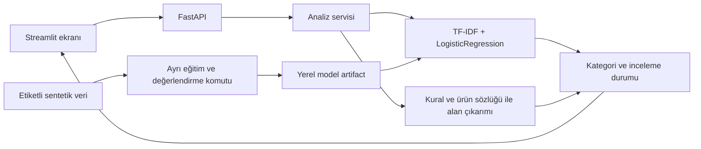

# TicketMind-TR

## v0.2 · Beş aşamalı öğrenme atölyesi

- **Analiz:** dört kategorinin kalibre edilmemiş skorları; başlangıç, kelime, karakter ve eğitilmiş TinyBERT model seçimi.
- **Veri atölyesi:** kendi mesajını ve alan konumlarını etiketleme, yerel SQLite kayıtları, JSONL indirme. Kişisel kayıtlar Git'e eklenmez; eğitim/test dosyalarına otomatik karışmaz. 32 yeni sentetik geliştirme örneği ayrıca görüntülenir.
- **Model deneyleri:** kelime/karakter TF-IDF karşılaştırması ve isteğe bağlı gerçek Türkçe TinyBERT fine-tuning; arka plan işi ve durum takibi. Seçim yalnız doğrulama macro F1 ile yapılır.
- **Alan değerlendirmesi:** 24 sentetik silver örnekte tam alan/konum precision, recall ve F1; hatalar saklanır.
- **Kaynaklı yanıt:** 16 kurgusal FAQ üzerinde çevrimdışı kelime arama veya Ollama embedding; pasaj gösterimi veya yerel LLM taslağı. Kaynak ID ve alıntı kontrolü, cevabın tüm iddialarının doğru olduğunu garanti etmez.

### Yeni komutlar

```powershell
python -m ticketmind.experiments
python -m ticketmind.entity_eval
python -m ticketmind.rag_eval --output reports/rag.json
```

Transformer için önce resmi CPU PyTorch paketini ve transformer eklentisini kurun:

```powershell
python -m pip install torch --index-url https://download.pytorch.org/whl/cpu
python -m pip install -e ".[transformer]"
python -m ticketmind.experiments --include-transformer --epochs 3
```

İlk transformer koşusu sabit HF sürümünden yaklaşık 18 MB model indirir. `HF_HOME` ile cache dizini belirlenebilir. Ağ olmadan hazır cache için `--local-files-only` kullanın. Model ağırlıkları depoya eklenmez.

Gerçek RAG için yerel Ollama üzerinde `embeddinggemma` ve bir üretim modeli gerekir:

```powershell
ollama pull embeddinggemma
$env:TICKETMIND_LLM_MODEL="qwen3.5:4b"
```

Varsayılan üretim modeli `qwen2.5:7b`'dir. Paket indirme/eğitim sunucu açılışında başlamaz. UI'deki deney düğmesi açık bir eğitim isteğidir. LLM yoksa açık durum mesajı döner; pasaj modu LLM kullanmaz.

Yeni belgeler: [Veri atölyesi](docs/data-workbench.md), [deneyler](docs/experiments.md), [RAG](docs/rag.md). Aşağıdaki v0.1 açıklamaları başlangıç modelinin tarihsel sözleşmesini anlatır; v0.2 sonuçları `reports/model_comparison.md`, `reports/entities.md`, `reports/rag.json` dosyalarındadır. Eski test geliştirmede incelendiği için yeni bağımsız holdout sayılmaz. Kullanıcı tarafından henüz insan yazımı bağımsız test verisi sağlanmamıştır.

[](https://github.com/sukriyeipeek/TicketMind-TR/actions/workflows/tests.yml)

Türkçe müşteri destek mesajlarını **kargo, ödeme, iade ve teknik sorun** niyetlerine ayıran bir NLP öğrenme projesi. Başlangıç modeli TF-IDF + lojistik regresyondur. Sipariş numarası, hata kodu ve küçük bir ürün sözlüğündeki ifadeler orijinal metindeki konumlarıyla çıkarılır.

**Durum: v0.1 eğitim demosu.** Veri AI yardımıyla yazılmış sentetik örneklerden oluşur. Her çıktı insan incelemesi gerektirir; model skoru kalibre edilmiş doğruluk olasılığı değildir. Gerçek müşteri performansı, kapsam dışı mesaj tespiti ve öğrenilmiş NER henüz değerlendirilmedi. LLM/RAG sonraki aşamadır.

## Örnek

> TM-1042 numaralı siparişimdeki kulaklığı iade etmek istiyorum. Nasıl başvurabilirim?

Hedef: `iade` kategorisi; `TM-1042` sipariş numarası ve `kulaklığı` ürün ifadesi. Kategori gerçek eğitilmiş modelden gelir. Ürün değeri metinde bulunduğu biçimiyle korunur; normalleştirilmiş katalog adı değildir.

## Mimari



API model eğitimini başlatmaz. Eğitim komutu modeli ve raporları üretir; API modeli başlangıçta bir kez yükler. Streamlit yalnız API'ye istek gönderir. Model bulunamazsa `/health` ve `/analyze` 503 verir.

## Kurulum

Python 3.12 önerilir. Bu teslim Windows x64 / CPython 3.12 üzerinde kontrol edilir. Proje klasöründe PowerShell açın:

```powershell
py -3.12 -m venv .venv
.\.venv\Scripts\python.exe -m pip install -e ".[dev]"
.\.venv\Scripts\python.exe -m ticketmind.train
```

Aktivasyon zorunlu değildir; komutlarda ortamın Python'unu doğrudan kullanıyoruz. `requirements-lock.txt`, bu teslimde kontrol edilen ortamın sabit sürüm listesidir. Aynı sürümlerle kurmak için:

```powershell
.\.venv\Scripts\python.exe -m pip install -r requirements-lock.txt
.\.venv\Scripts\python.exe -m pip install --no-deps --no-build-isolation -e .
```

Lock dosyası sürüm sabitler; hash kilidi veya bütün platformlar için doğrulama iddiası taşımaz. Model dosyası Git'e eklenmez; ortamda yeniden eğitilir. Yalnız kendi ürettiğiniz güvenilir yerel `joblib` dosyasını yükleyin.

## Kullanım

Eğitilmiş modeli terminalden denemek için:

```powershell
.\.venv\Scripts\python.exe -m ticketmind.predict "TM-1042 siparişimdeki kulaklığı iade etmek istiyorum."
```

API'yi bir terminalde başlatın:

```powershell
.\.venv\Scripts\python.exe -m uvicorn ticketmind.api:app --host 127.0.0.1 --port 8000
```

Demo ekranını ikinci terminalde başlatın:

```powershell
.\.venv\Scripts\python.exe -m streamlit run demo/app.py --server.address 127.0.0.1 --server.port 8501
```

Ekran: <http://127.0.0.1:8501> · API belgeleri: <http://127.0.0.1:8000/docs>

Portlar doluysa başka port seçebilirsiniz. Örneğin API'yi `--port 18000` ile başlatın; demo terminalinde `$env:TICKETMIND_API_URL="http://127.0.0.1:18000/analyze"` ayarlayıp Streamlit'i `--server.port 18501` ile çalıştırın.

```powershell
$body = @{ text = "TM-1042 siparişimdeki kulaklığı iade etmek istiyorum." } | ConvertTo-Json
Invoke-RestMethod -Uri http://127.0.0.1:8000/analyze -Method Post -ContentType 'application/json; charset=utf-8' -Body ([Text.Encoding]::UTF8.GetBytes($body))
```

API yanıtı `category`, `model_score`, `score_type`, `needs_review`, `review_reasons`, `entities` ve `model_version` alanlarını taşır. Mesaj 1–4000 karakter olmalı; boşluk-only veya metin olmayan girdiler 422 ile reddedilir. `category=null`, hiç bilinen TF-IDF özelliği bulunmadığı anlamına gelir; genel kapsam dışı tespiti değildir. Başka kapsam dışı mesajlar dört kategoriden birine atanabilir. `needs_review` bu demo sürümünde daima `true` olur.

## Veri ve değerlendirme

- Dört kategori, sabit `train`, `validation`, `test` bölmeleri.
- Aynı senaryonun yakın ifadeleri aynı `group_id` altında ve tek bölmede tutulur.
- Normalize birebir kopyalar ve bölmeler arası grup çakışması eğitimden önce reddedilir. Benzer anlamlı tüm mesajların bağımsızlığı garanti edilmez.
- TF-IDF sözlüğü ve IDF değerleri yalnız eğitim kümesinde öğrenilir.
- Model ayarları bu başlangıç sürümünde sabittir; testten hiperparametre/eşik seçilmez.
- Most-frequent dummy model ile karşılaştırma, macro F1, sınıf bazında precision/recall ve hata matrisi raporlanır.
- Alan çıkarımı için kural testleri vardır; ayrıca etiketlenmiş bağımsız bir NER test kümesi henüz yoktur.

Sonuçlar: [rapor](reports/baseline.md) · [makine tarafından okunabilir rapor](reports/baseline.json)

Veriyi değiştirdiğinizde raporu yeniden üretin. Mevcut test setinde tekrar tekrar iyileştirme yapmak bağımsız test özelliğini zayıflatır; karşılaştırma öncesinde yeni, insan yazımı bir holdout hazırlamak yol haritasındadır.

## Öğrenme yolu

1. [Etiketleme kılavuzu](docs/annotation.md): bir mesajın niyetine nasıl karar veriyoruz?
2. [İlk ders](docs/first-lesson.md): bir örneği veri → vektör → tahmin akışında izle.
3. [Veri kartı](docs/data-card.md): veri nereden geliyor, neyi ölçebiliriz?
4. `src/ticketmind/train.py`: eğitim ile değerlendirme neden ayrı?
5. `src/ticketmind/service.py` ve `api.py`: eğitilmiş model nasıl kullanılıyor?

## Doğrulama

```powershell
.\.venv\Scripts\python.exe -m pytest -q
.\.venv\Scripts\python.exe -m pip check
```

Testler grup/veri sızıntısı sözleşmesini, Türkçe karakterleri ve alan konumlarını, gerçek model kaydetme-yükleme akışını ve API sınırlarını kontrol eder. API sınır testleri küçük bir stub kullanır; model testleri gerçek TF-IDF/LR hattını çalıştırır.

İlk teslimdeki kontroller: [doğrulama notu](docs/verification.md).

## Sonraki aşamalar

- İnsan yazımı örnekler ve etiketleme incelemesi; ayrı alan çıkarımı etiketleri.
- Aynı sabit bölmeler üzerinde transformer sınıflandırıcı karşılaştırması.
- Doğrulama verisi üzerinde kalibrasyon ve incelemeye yönlendirme politikası; ayrı kapsam dışı değerlendirmesi.
- Hazırlanmış yardım belgelerinden retrieval ve kaynaklı LLM yanıt taslağı. Kategori aramaya yardımcı olacak; doğru kaynakları tamamen dışlayan zorunlu filtre olmayacak.

